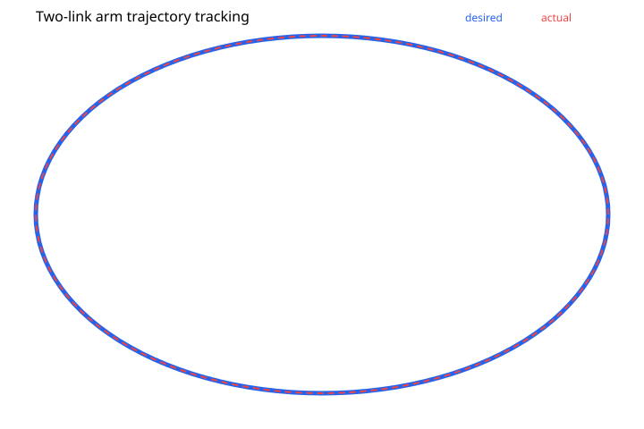
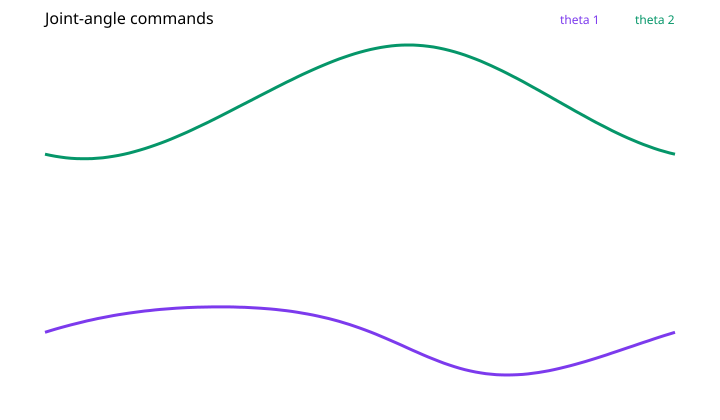

# Robotic Arm Control

**Analytical inverse kinematics and Cartesian trajectory reconstruction for a planar two-link robot**

  

## Overview

This repository demonstrates a transparent, dependency-free inverse-kinematics workflow for a two-link planar robot. It generates a closed elliptical target path, computes joint angles using an analytical elbow configuration, reconstructs the end-effector path with forward kinematics, and records Cartesian error.

The objective is to check numerical consistency of inverse and forward kinematics, **not** to demonstrate closed-loop tracking on a physical manipulator.

## Mathematical model

With link lengths $L_1=1.0$ and $L_2=0.8$, forward kinematics are

$$x=L_1\cos\theta_1+L_2\cos(\theta_1+\theta_2)$$

$$y=L_1\sin\theta_1+L_2\sin(\theta_1+\theta_2).$$

The inverse-kinematics calculation uses the law of cosines followed by two `atan2` terms. The implementation selects the positive-`acos` elbow configuration and checks target reachability.

## Demonstration

- **Target:** 121 points on a closed ellipse centered at $(0.95,0.55)$ with radii $(0.35,0.28)$.
- **Output:** Joint commands, reconstructed end-effector coordinates, reachability status, and error metrics.
- **Check:** Euclidean error between the requested and reconstructed Cartesian points.





### Reported synthetic-demo results

| Metric | Value |
|---|---:|
| Trajectory samples | 121 |
| Reachable targets | 121 / 121 |
| Position RMSE | `1.462e-16` coordinate units |
| Maximum position error | `3.140e-16` coordinate units |

Near-machine-precision error is expected for internally consistent analytical kinematics. It does **not** measure actuator tracking, mechanical positioning accuracy, or robot calibration.

## Outputs

`Results/trajectory.csv` stores the sampled trajectory, `Results/metrics.json` stores summary statistics, and the two SVG figures visualize Cartesian reconstruction and joint angles.

## Limitations and extensions

This baseline omits joint limits, dynamics, actuator torque, control sampling, obstacles, collisions, backlash, and sensor noise. Next steps are joint-space constraints, dynamic simulation, PID or model predictive control, and hardware validation with measured trajectories.

## Reproduce the results

```bash
git clone https://github.com/nabinkandel07/Robotic-Arm-Control.git
cd Robotic-Arm-Control
python src/run_demo.py
python -m unittest discover -s tests -v
```

**Requirements:** Python 3.10 or later is recommended. The current demonstration uses only the Python standard library; no third-party dependencies are required.

## Repository structure

```text
.
├── src/run_demo.py       # Runnable demonstration
├── tests/test_demo.py    # Verification tests
├── docs/
│   ├── METHODOLOGY.md    # Model and experimental design
│   ├── RESULTS.md        # Result interpretation and limitations
│   └── DATA_DICTIONARY.md
├── requirements.txt
├── CITATION.cff
└── README.md
```

See the `results/` directory for the committed evaluation artifacts and figures, except the robotics repository, which uses `Results/`.

## Documentation and citation

Detailed assumptions and experimental settings are documented in [Methodology](docs/METHODOLOGY.md). See [Results](docs/RESULTS.md) for interpretation and [Data Dictionary](docs/DATA_DICTIONARY.md) for exported fields. Citation metadata is provided in [CITATION.cff](CITATION.cff).

## Author

**Nabin Kandel**  
Control Science and Engineering, Zhejiang Sci-Tech University  
[GitHub](https://github.com/nabinkandel07) · [Email](mailto:nabinkandel60@gmail.com)
